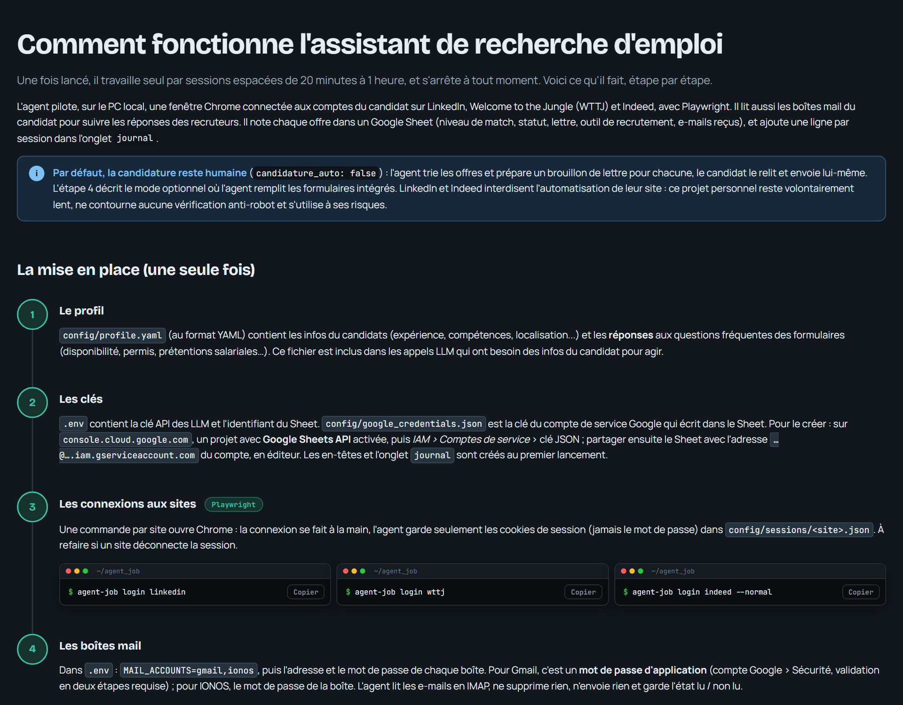

# agent_job

Assistant de recherche d'emploi à base d'agents LLM : il cherche des offres sur LinkedIn, Welcome to the Jungle et
Indeed, les fait évaluer par un LLM face au profil, prépare un brouillon de lettre de motivation pour celles qui
correspondent et suit les réponses des recruteurs par e-mail, le tout dans un Google Sheet.

**👉 Tout le fonctionnement, étape par étape : [page explicative](https://agent-job.tanguym.fr/)**
(ou [`interface/fonctionnement.html`](interface/fonctionnement.html) à ouvrir dans un navigateur).

[](https://agent-job.tanguym.fr/)

## Démarrage rapide

```powershell
py -3.13 -m venv .venv
.venv\Scripts\activate
pip install -e .
playwright install chromium
copy .env.example .env
copy config\profile.example.yaml config\profile.yaml
```

Remplir `.env` et `config/profile.yaml`, puis suivre la mise en place décrite dans la page.

Python, Playwright, API Mistral (lots), Google Sheets, IMAP. Projet personnel d'apprentissage : LinkedIn et Indeed
interdisent l'automatisation de leur site, l'agent reste volontairement lent et ne contourne aucune vérification
anti-robot.
